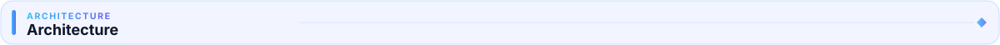
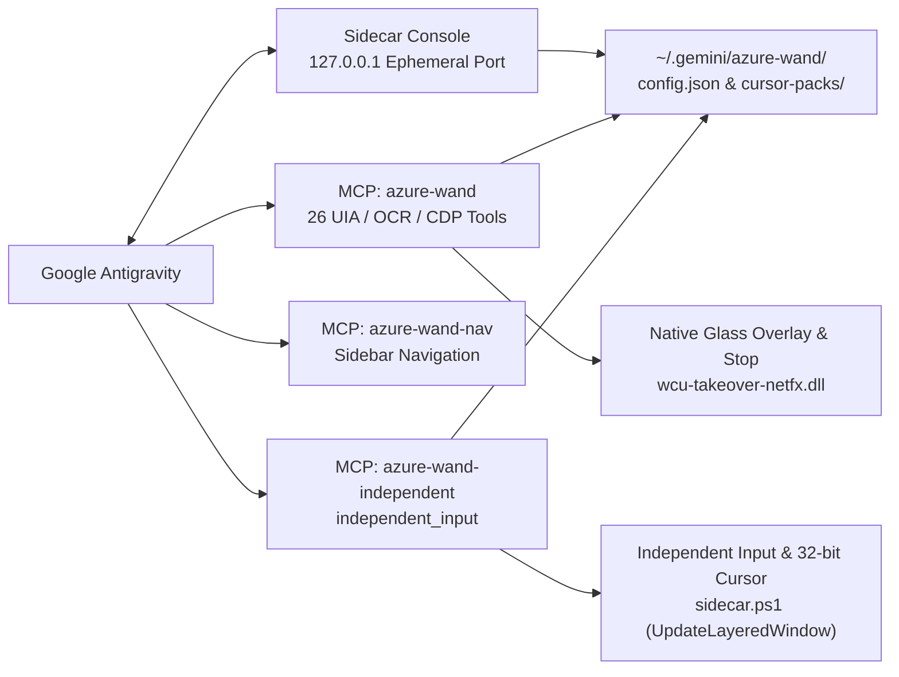
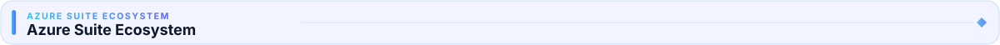

<div align="center">

<p>🌐 &nbsp; <a href="README.md">简体中文</a> &nbsp;·&nbsp; <strong>English</strong></p>

<picture>
  <source media="(prefers-color-scheme: dark)" srcset="assets/readme/hero-en-dark.svg">
  
</picture>

<p>
  <a href="https://github.com/A16Nights/antigravity-azure-wand/releases"></a>
  <a href="https://github.com/A16Nights/antigravity-azure-wand/stargazers"></a>
  
  
  
  <a href="./LICENSE"></a>
</p>

<p>
  <strong>Low-Intrusion Windows Desktop & Web Automation · 15-State Independent AI Cursor · Custom Pack Gallery & Importer · 4 Glass Overlay Themes</strong>
</p>

<p>
  <a href="#features">✨ Features</a> &nbsp;·&nbsp; <a href="#architecture">🧩 Architecture</a> &nbsp;·&nbsp; <a href="#installation">🚀 Installation</a> &nbsp;·&nbsp; <a href="#storage">📂 Storage</a> &nbsp;·&nbsp; <a href="#azure-suite">🌌 Azure Suite</a>
</p>

</div>

A low-intrusion Windows desktop & web visual automation plugin for **Google Antigravity** (3 dedicated MCP servers + left/right sidebar control console). It prioritizes **background UI Automation, window messages, and browser CDP** without stealing your physical mouse or keyboard focus, featuring a click-through **15-state animated AI cursor**, **4 Azure glass thinking overlay themes**, **customizable cursor tag**, and instant hardware-level `Esc` / `Ctrl+Alt+Q` stop controls.

<table>
<tr>
<td width="50%" valign="top">
<h4>🪄 Independent Input & 15-State AI Cursor</h4>
<code>independent_input</code> operates strictly via UIA / window messages on target windows — <strong>never moves your physical mouse or steals focus</strong>. Uses Win32 <code>UpdateLayeredWindow</code> 32-bit per-pixel alpha rendering with Companion / Clean / Avoidance fade modes and <code>Ctrl+Alt+Q</code> pause.
</td>
<td width="50%" valign="top">
<h4>🎨 Pack Gallery · Per-State Mix · Importer</h4>
Built-in zero-dependency binary parser for Windows <code>.cur</code> / <code>.ani</code> / <code>.ico</code> / <code>install.inf</code> / <code>.zip</code> / <code>.rar</code> cursor packs. Switch full suites in one click or mix different packs per cursor state.
</td>
</tr>
<tr>
<td width="50%" valign="top">
<h4>🧰 26 Windows UIA / OCR / CDP Tools</h4>
Prefers background browser CDP and native Windows UI Automation, falling back to native OCR and screenshots for custom-rendered canvases. Toggle every tool individually and manage app launch allowlists.
</td>
<td width="50%" valign="top">
<h4>🪟 4 Glass Overlays & Hardware Esc Stop</h4>
Includes 4 Azure glass progress overlay themes and dynamic-width gradient pointer tags with 3-second live preview, click-through lock, and millisecond-level <code>Esc</code> emergency stop.
</td>
</tr>
</table>

<h2 id="features">
<picture>
  <source media="(prefers-color-scheme: dark)" srcset="assets/readme/sec-features-en-dark.svg">
  
</picture>
</h2>

### 1. Independent Input & 15-State Animated AI Cursor (`azure-wand-independent`)
- **Zero-Steal Execution**: Targets windows by `hwnd` through UI Automation and window messages so you can keep typing, scrolling, and using your real mouse undisturbed.
- **Per-Pixel Alpha Overlay**: Powered by Win32 `UpdateLayeredWindow` (32-bit premultiplied ARGB), supporting crisp pixel scaling (<=64px) and smooth HD scaling (>=96px) with per-pack frame counts and timing from `meta.json`.
- **Three Display Modes**:
  - **Companion**: Stays visible throughout the workflow.
  - **Clean**: Auto-hides after a configurable hold delay (400–15000ms).
  - **Avoidance**: Softly fades out after 800ms idle so it never blocks text, snapping back in 80ms on movement.
- **Instant Pause**: Press `Ctrl+Alt+Q` anytime to pause independent actions.

### 2. Cursor Pack Gallery, Per-State Mix & External Importer
- **5 Built-In Animated Cursor Packs**: Ships ready-to-use with **Azure Starlight**, **Summer Kyoka (Swimsuit Animated)**, **Gemini Original**, **Gemini Plus**, and **DeepSeek Whale Girl** for instant one-click switching.
- **External Cursor Pack Importer**: Pure Node.js decoder for `.cur` / `.ico` (PNG & 32/24/8/4/1bpp DIB + AND masks) and RIFF `ACON` `.ani` animations, supporting `install.inf`, frame-sequence folders, `.zip` / `.rar` archives, and drag-and-drop file uploads.
- **Suite Switching & State Mixing**: Switch full cursor suites from the visual gallery or override any individual state (e.g. `pointer`, `link`, `work`, `unavailiable`) from another installed pack.

### 3. 26 Windows Desktop & Browser Tools (`azure-wand`)
- **Browser-First CDP**: Interacts with web pages in the background with an in-page virtual pointer.
- **Desktop UIA + OCR**: Complete toolkit (`snapshot`, `find`, `invoke`, `set_value`, `ocr`, `screenshot`, `list_windows`, `batch`, etc.) with 4 scene presets and granular tool checkboxes.

### 4. Azure Glass Overlays & Emergency Stop
- **4 Glass Themes**: `azure`, `abyss`, `lavender`, and `frost`, with live opacity, dimensions, position, and click-through lock controls.
- **Hardware `Esc` Stop**: Dedicated takeover monitor intercepts `Esc` (or custom hotkey) immediately and returns `COMPUTER_USE_STOPPED_BY_USER`.

<h2 id="architecture">
<picture>
  <source media="(prefers-color-scheme: dark)" srcset="assets/readme/sec-arch-en-dark.svg">
  
</picture>
</h2>



<h2 id="installation">
<picture>
  <source media="(prefers-color-scheme: dark)" srcset="assets/readme/sec-install-en-dark.svg">
  
</picture>
</h2>

### Option 1: Ask Antigravity to Install It (Recommended)

Send this prompt to Antigravity:

> Clone `https://github.com/A16Nights/antigravity-azure-wand.git` into my global Antigravity plugins directory as `azure-wand`, verify the files, and let me know so I can reload with `Ctrl+R`.

### Option 2: Manual Clone

```powershell
# Windows (PowerShell)
git clone https://github.com/A16Nights/antigravity-azure-wand.git "$env:USERPROFILE\.gemini\config\plugins\azure-wand"
```

Reload Antigravity (`Ctrl+R`), enable **Azure Wand** in **Plugins**, and open it from the left sidebar or right-hand Sidecar panel.

> **Requirements**: Windows 10 / 11, Node.js >= 22, Windows PowerShell 5.1.

<h2 id="storage">
<picture>
  <source media="(prefers-color-scheme: dark)" srcset="assets/readme/sec-storage-en-dark.svg">
  
</picture>
</h2>

<details open>
<summary><strong>Click to inspect local data paths & shared Azure Suite configs</strong></summary>

<br>

- **Azure Wand Config**: `~/.gemini/azure-wand/config.json`
- **Local Imported Cursor Packs**: `~/.gemini/azure-wand/cursor-packs/`
- **Shared Azure Suite Theme**: `~/.gemini/azure-theme.json`
- **Azure Suite Sidebar Visibility**: `~/.gemini/azure-sidebar-nav.json`

</details>

<h2 id="azure-suite">
<picture>
  <source media="(prefers-color-scheme: dark)" srcset="assets/readme/sec-suite-en-dark.svg">
  
</picture>
</h2>

All **9 Azure Suite plugins** share a unified **Neko Glass UI**, synchronized **Azure Theme Center** (`~/.gemini/azure-theme.json`), and customizable **Sidebar Navigation Hub** (`~/.gemini/azure-sidebar-nav.json`):

| Plugin | Repository | Core Capability |
| --- | --- | --- |
| ✦ **External Orchestrator** | [antigravity-external-orchestrator](https://github.com/A16Nights/antigravity-external-orchestrator) | Multi-provider external worker routing, custom profiles, circuit breaker & live monitoring |
| 🪐 **Azure Orbit** | [antigravity-azure-orbit](https://github.com/A16Nights/antigravity-azure-orbit) | Mount external LLM APIs directly into Antigravity's native bottom-left model selector |
| 🧭 **Azure Compass** | [antigravity-azure-compass](https://github.com/A16Nights/antigravity-azure-compass) | Agent mode presets, live context telemetry with auto /compact, update radar & sidebar hub |
| 🏛️ **Azure Corridor** | [antigravity-azure-corridor](https://github.com/A16Nights/antigravity-azure-corridor) | Read-only FTS5 conversation search, custom project groups, priority tags & safe archive |
| 🌌 **Lanxi Memory** | [antigravity-lanxi-memory](https://github.com/A16Nights/antigravity-lanxi-memory) | 5-layer Markdown cognitive graph, CJK FTS5, tidal forgetting curves & starfield UI |
| 💎 **Soul.md Studio** | [antigravity-soul-md](https://github.com/A16Nights/antigravity-soul-md) | Hot-swappable persona cards, workspace binding, external-model anchor & layered memory |
| 💭 **Think-ZH** | [antigravity-think-zh](https://github.com/A16Nights/antigravity-think-zh) | Simplified Chinese / English reasoning switcher with dual-channel anti-drift hooks |
| 🔮 **Azure Prism** | [antigravity-azure-prism](https://github.com/A16Nights/antigravity-azure-prism) | Native MCP App Chain-of-Thought viewer with keyless zero-token MT & LLM translation |
| 🪄 **Azure Wand** &nbsp;`✦ This Repo` | [antigravity-azure-wand](https://github.com/A16Nights/antigravity-azure-wand) | Low-intrusion Windows desktop & web automation with 15-state independent AI cursor, pack gallery & importer |

---

## Credits & Cursor Pack Sources

The underlying automation and independent input engines are adapted from MIT-licensed upstream projects (see [LICENSE](./LICENSE) and [THIRD_PARTY.md](./THIRD_PARTY.md) for full attribution):
- [dsh-computer-use-win](https://github.com/Yu-tao-Li/dsh-computer-use-win)
- [dsh-independent-input](https://github.com/dongcaodeliyu/dsh-independent-input)

Sources of the 5 bundled animated cursor packs (all freely shared online or original artwork; third-party artwork remains copyright of its respective authors for non-commercial community use):
- **Azure Starlight**: Original MIT-licensed animated cursor pack created for Azure Wand.
- **Gemini Original / Gemini Plus**: [nibushiyigeren123-bot/gemini-cursors (v1.3.0)](https://github.com/nibushiyigeren123-bot/gemini-cursors/releases/tag/v1.3.0)
- **Summer Kyoka (Swimsuit Animated)**: [Bilibili BV1FPbVzFEC3](https://www.bilibili.com/video/BV1FPbVzFEC3/)
- **DeepSeek Whale Girl**: From [dsh-independent-input](https://github.com/dongcaodeliyu/dsh-independent-input) (publicly shared free cursor artwork).

<div align="center">

📄 Released under the <a href="./LICENSE"><strong>MIT License</strong></a> · Crafted for <strong>Google Antigravity</strong>

</div>
