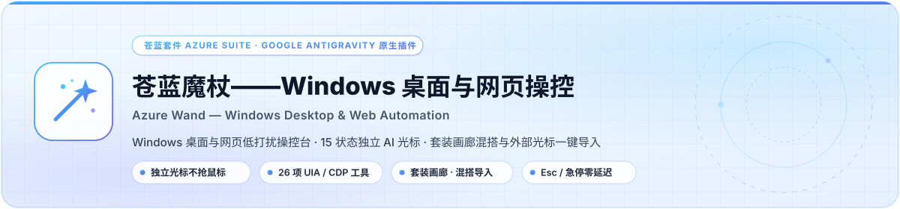
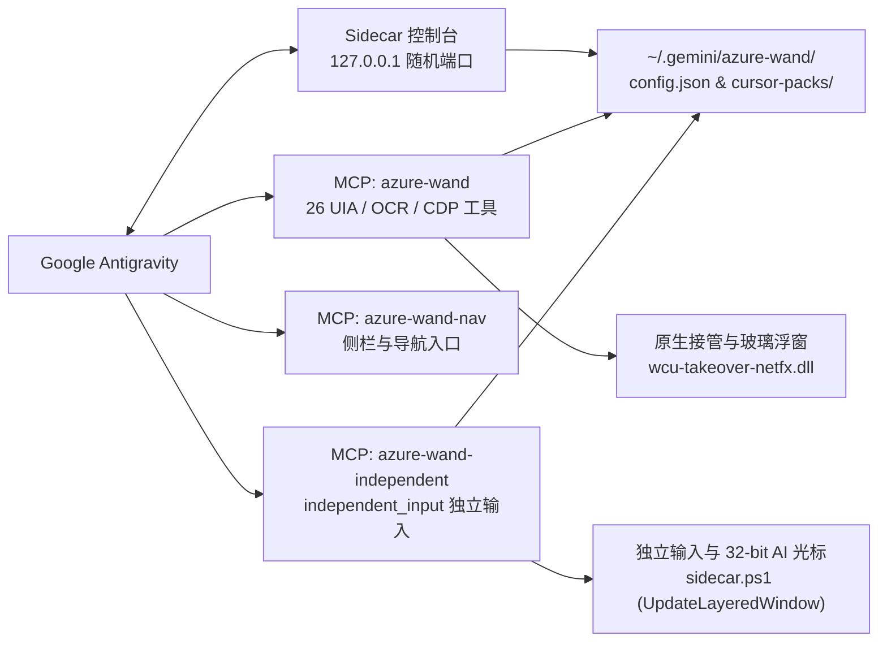

<div align="center">

<p>🌐 &nbsp; <strong>简体中文</strong> &nbsp;·&nbsp; <a href="README.en.md">English</a></p>

<picture>
  <source media="(prefers-color-scheme: dark)" srcset="assets/readme/hero-dark.svg">
  
</picture>

<p>
  <a href="https://github.com/A16Nights/antigravity-azure-wand/releases"></a>
  <a href="https://github.com/A16Nights/antigravity-azure-wand/stargazers"></a>
  
  
  
  <a href="./LICENSE"></a>
</p>

<p>
  <strong>苍蓝魔杖——Windows 桌面与网页操控 · Windows 桌面与网页低打扰操控台 · 独立输入 15 状态动态 AI 光标 · 套装画廊混搭与外部光标一键导入 · 4 套苍蓝玻璃思考浮窗</strong>
</p>

<p>
  <a href="#features">✨ 功能全景</a> &nbsp;·&nbsp; <a href="#architecture">🧩 工作原理</a> &nbsp;·&nbsp; <a href="#installation">🚀 快速安装</a> &nbsp;·&nbsp; <a href="#storage">📂 数据存储</a> &nbsp;·&nbsp; <a href="#azure-suite">🌌 苍蓝全家桶</a>
</p>

</div>

面向 **Google Antigravity** 的 Windows 桌面与网页低打扰可视化操控插件（3 组独立 MCP 服务 + 左侧栏/右侧 Sidecar 双入口控制面板）。在不抢你鼠标与键盘焦点的前提下，优先通过 **独立输入（UIA / 窗口消息）** 与 **浏览器后台 CDP 通道** 执行操作，并配有置顶穿透的 **15 状态动态 AI 光标**、**4 套苍蓝玻璃思考浮窗**、**自定义鼠标提示标签** 以及硬件级 `Esc` / `Ctrl+Alt+Q` 随时急停。

<table>
<tr>
<td width="50%" valign="top">
<h4>🪄 独立输入 · 15 状态动态 AI 光标</h4>
通过 <code>independent_input</code> 严格走目标窗口 UIA / 窗口消息，<strong>绝不动真实鼠标、绝不抢焦点</strong>；32-bit 逐像素透明渲染无紫边，支持「陪伴 / 整洁 / 避让淡出」三种显示模式与 <code>Ctrl+Alt+Q</code> 急停。
</td>
<td width="50%" valign="top">
<h4>🎨 套装画廊 · 单状态混搭 · 外部光标导入</h4>
内置纯 Node.js 二进制解码器，支持直接路径或拖拽导入 <code>.cur</code> / <code>.ani</code> / <code>.ico</code> / <code>install.inf</code> / <code>.zip</code> / <code>.rar</code> 光标包，一键切换整套外观或为 15 个状态自由跨套装混搭。
</td>
</tr>
<tr>
<td width="50%" valign="top">
<h4>🧰 26 项 Windows UIA / OCR / CDP 工具</h4>
优先后台网页 CDP 与 Windows UI Automation 控件交互，自绘界面自动用原生 OCR 与像素截屏兜底；支持在面板中按四大分类精细开关任意工具与配置应用启动白名单。
</td>
<td width="50%" valign="top">
<h4>🪟 4 套苍蓝玻璃思考浮窗 & 硬件急停</h4>
提供苍蓝星辉、深海星曜、星雾薰衣草、冰川霜蓝 4 套玻璃卡片主题与动态测宽渐变鼠标标签，支持实时 3 秒预览与鼠标穿透锁定，按 <code>Esc</code> 毫秒级叫停。
</td>
</tr>
</table>

<h2 id="features">
<picture>
  <source media="(prefers-color-scheme: dark)" srcset="assets/readme/sec-features-dark.svg">
  
</picture>
</h2>

### 1. 独立输入与 15 状态动态 AI 光标（`azure-wand-independent`）
- **严格零打扰通道**：针对目标窗口句柄 `hwnd` 使用 UI Automation 与窗口消息交互，你可以继续正常移动自己的鼠标、打字或切换窗口，互不干扰。
- **逐像素 Alpha 渲染引擎**：基于 Win32 `UpdateLayeredWindow` 32-bit 预乘 Alpha 渲染，自适应 64px 像素锐利缩放与 128px 高清抗锯齿缩放，自动读取每套包的真实帧数与帧率。
- **三种显示方式**：
  - **陪伴模式**：执行期间常驻屏幕，直观看到 AI 正在操作哪里；
  - **整洁模式**：每次动作完成后按自定义延时（400~15000ms）自动收起；
  - **避让淡出模式**：停留 800ms 后轻柔淡出不挡文字，下次移动 80ms 瞬回显现。
- **随时暂停**：按下 `Ctrl+Alt+Q` 立即暂停独立输入并在光标上切为「禁止」状态。

### 2. 光标套装画廊、单状态混搭与外部外观导入
- **开箱内置 5 套精选动态光标套装**：包含 **苍蓝星芒**、**夏日镜华 · 泳装动画套装**、**Gemini · 经典紫晶原版**、**Gemini · Plus 醒目符号版**、**DeepSeek · 鲸鱼娘**，无需折腾转换即可在画廊中一键切换。
- **外部光标一键导入**：纯 Node.js 解码 Windows `.cur` / `.ico`（含 PNG 压缩帧与 32/24/8/4/1bpp DIB + AND Mask）及 RIFF `ACON` `.ani` 动图，支持导入 `install.inf` 整包、逐帧目录、`.zip` / `.rar` 压缩包或零散单文件。
- **整套切换 + 单状态混搭**：点击画廊卡片即可一键切换整套光标并实时在屏幕上试看；也可以在 15 状态卡片的下拉菜单里，把任意单个状态（如指针、链接、等待、禁止等）指定为另一套光标包的外观。

### 3. 26 项 Windows 桌面 / 网页低打扰工具（`azure-wand`）
- **网页优先（CDP）**：后台连接浏览器读写 DOM 与触发交互，并在页面内展示虚拟蓝箭头，不抢物理指针。
- **原生桌面（UIA + OCR）**：支持 `snapshot`、`find`、`invoke`、`set_value`、`ocr`、`screenshot`、`list_windows`、`batch` 等 26 项完整工具。
- **场景预设与精细开关**：侧栏提供「静默低打扰（推荐）/ 极速前台托管 / 只读观测哨兵 / 精简 12 工具」一键切换，并支持逐项勾选与 `launch_app` 路径白名单。

### 4. 苍蓝玻璃思考浮窗、鼠标标签与安全急停
- **4 套玻璃浮窗主题**：`苍蓝星辉 (azure)`、`深海星曜 (abyss)`、`星雾薰衣草 (lavender)`、`冰川霜蓝 (frost)`，可自定义透明度、宽高、位置与鼠标穿透锁定。
- **动态测宽鼠标标签**：自定义标签文案、屏幕边缘光晕与顶部/底部提示胶囊，点击面板按钮即可 3 秒实时预览。
- **硬件级 `Esc` 急停**：独立接管进程直接监听 `Esc`（可自定义快捷键），触发后立即返回 `COMPUTER_USE_STOPPED_BY_USER` 并交还控制权。


### 首次使用交互式新手引导（`? 指南`）
- **4 步上手教程 + 真实控件定位高亮**：首次打开面板自动弹出分步功能指南，点击「🎯 定位」按钮可在当前界面脉冲高亮对应控件并附带浮动返回条。
- **本机持久化不复弹**：已读状态保存至 `~/.gemini/azure-onboarding.json`（Sidecar 重启换端口不复弹），日后随时可点击顶栏 **`? 指南`** 重看。

<h2 id="architecture">
<picture>
  <source media="(prefers-color-scheme: dark)" srcset="assets/readme/sec-arch-dark.svg">
  
</picture>
</h2>



<h2 id="installation">
<picture>
  <source media="(prefers-color-scheme: dark)" srcset="assets/readme/sec-install-dark.svg">
  
</picture>
</h2>

### 方式一：一句话让 Antigravity 帮你安装（推荐）

直接把下面这句话发给 Antigravity：

> 帮我把 `https://github.com/A16Nights/antigravity-azure-wand.git` 克隆到本机 Antigravity 全局插件目录，目录名设为 `azure-wand`，检查目录无误后告诉我，我再按 `Ctrl+R` 重载生效。

### 方式二：手动克隆安装

```powershell
# Windows (PowerShell)
git clone https://github.com/A16Nights/antigravity-azure-wand.git "$env:USERPROFILE\.gemini\config\plugins\azure-wand"
```

安装完成后按 `Ctrl+R` 重载 Antigravity，在插件列表确认已启用 **苍蓝魔杖（azure-wand）**，即可从**左侧栏**或**右侧 Sidecar 面板**打开控制台。

> **环境要求**：Windows 10 / 11、Node.js >= 22、Windows PowerShell 5.1（系统自带）。

<h2 id="storage">
<picture>
  <source media="(prefers-color-scheme: dark)" srcset="assets/readme/sec-storage-dark.svg">
  
</picture>
</h2>

<details open>
<summary><strong>点击展开查看本机数据目录与苍蓝套件共享配置路径</strong></summary>

<br>

- **苍蓝魔杖主配置文件**：`~/.gemini/azure-wand/config.json`（工作模式、浮窗主题、标签与光标设置保存后实时热生效）
- **本机导入的光标套装库**：`~/.gemini/azure-wand/cursor-packs/`（仅存本机个人目录，导入的任何外部光标均保存在此处）
- **苍蓝套件共享主题配置**：`~/.gemini/azure-theme.json`
- **苍蓝套件左侧栏显示配置**：`~/.gemini/azure-sidebar-nav.json`

</details>

<h2 id="azure-suite">
<picture>
  <source media="(prefers-color-scheme: dark)" srcset="assets/readme/sec-suite-dark.svg">
  
</picture>
</h2>

**苍蓝套件（Azure Suite）** 11 款插件共享统一的 **Neko Glass 毛玻璃界面**、跨插件同步的 **苍蓝主题色调中心**（`~/.gemini/azure-theme.json`）以及可自由开关的 **左侧栏快捷入口**（`~/.gemini/azure-sidebar-nav.json`）：

| 插件 | 仓库 | 核心能力 |
| --- | --- | --- |
| ✦ **苍蓝协奏台——外部模型调度与省流** | [antigravity-external-orchestrator](https://github.com/A16Nights/antigravity-external-orchestrator) | 多渠道外部模型协同调度、自定义调度角色、容灾断路器、全链路监控与首次新手引导 |
| 🪐 **苍蓝星轨——原生菜单外接模型挂载** | [antigravity-azure-orbit](https://github.com/A16Nights/antigravity-azure-orbit) | 将外部大模型直接挂载进 Antigravity 左下角原生模型下拉菜单担任主脑 |
| 🧭 **苍蓝罗盘——Agent 预设与上下文监控** | [antigravity-azure-compass](https://github.com/A16Nights/antigravity-azure-compass) | Agent 工作模式预设中心、上下文水位监测与自动 /compact、苍蓝套件左侧栏总控 |
| 🏛️ **苍蓝回廊——会话与工作区管理** | [antigravity-azure-corridor](https://github.com/A16Nights/antigravity-azure-corridor) | 纯官方原生会话与工作区同步、FTS5 全文检索、自选快捷标签栏、跨工作区转移续聊与新手引导 |
| 🌌 **蓝汐——认知图谱长期记忆** | [antigravity-lanxi-memory](https://github.com/A16Nights/antigravity-lanxi-memory) | 五层纯 Markdown 真源记忆、CJK FTS5、潮汐遗忘曲线与交互式潮汐星海图谱 |
| 💎 **苍蓝魂匣——人设卡与分层记忆** | [antigravity-soul-md](https://github.com/A16Nights/antigravity-soul-md) | 多人设卡热切换、工作区专属绑定、外接模型智能防掉线锚点与分层文件记忆 |
| 💭 **思语中文——外接模型中文思考切换** | [antigravity-think-zh](https://github.com/A16Nights/antigravity-think-zh) | 外接推理模型内部思考简体中文 / 英文热切换、双通道防漂移与实时注入预览 |
| 🔮 **苍蓝棱镜——思维链观测与实时翻译** | [antigravity-azure-prism](https://github.com/A16Nights/antigravity-azure-prism) | 原生 MCP App 思维链实时观测、免密钥零 Token 机翻与外部模型双通道译文 |
| 🪄 **苍蓝魔杖——Windows 桌面与网页操控** &nbsp;`✦ 当前仓库` | [antigravity-azure-wand](https://github.com/A16Nights/antigravity-azure-wand) | Windows 桌面与网页低打扰操控台、独立输入 15 状态 AI 光标、套装画廊混搭与外部光标导入 |
| 🍃 **苍蓝流笺——拖拽发图与原生文件标签** | [antigravity-azure-drop](https://github.com/A16Nights/antigravity-azure-drop) | 零 `app.asar` 侵入、拖拽与粘贴插入原生文件标签、无损 PNG 截图落盘、图片缩略图灯箱与面包屑右键菜单 |
| 🔭 **苍蓝星瞳——多账号 Gemini 网页副脑** &nbsp;`Beta` | [antigravity-azure-lens](https://github.com/A16Nights/antigravity-azure-lens) | 1:1 原生双态 Gemini 侧栏、双标签物理隔离、多账号独立 Profile 自动检测、免跳转内部弹窗与 MCP 静默调研审阅 |

---

## 开源致谢与光标套装来源

本插件底层引擎基于以下 MIT 开源项目适配与扩展（完整许可声明见 [LICENSE](./LICENSE) 与 [THIRD_PARTY.md](./THIRD_PARTY.md)）：
- [dsh-computer-use-win](https://github.com/Yu-tao-Li/dsh-computer-use-win)（Windows UIA / OCR / CDP / 接管引擎）
- [dsh-independent-input](https://github.com/dongcaodeliyu/dsh-independent-input)（独立输入通道基础代码架构）

内置的 5 套动态光标套装来源如下（均来自网络公开免费分享或原创制作，第三方素材版权归原作者所有，仅作开源社区非商业体验配套）：
- **苍蓝星芒**：苍蓝魔杖内置原创 MIT 动态光标套装。
- **Gemini · 经典紫晶原版 / Gemini · Plus 醒目符号版**：[nibushiyigeren123-bot/gemini-cursors (v1.3.0)](https://github.com/nibushiyigeren123-bot/gemini-cursors/releases/tag/v1.3.0)
- **夏日镜华 · 泳装动画套装**：[Bilibili BV1FPbVzFEC3](https://www.bilibili.com/video/BV1FPbVzFEC3/)
- **DeepSeek · 鲸鱼娘**：来自 [dsh-independent-input](https://github.com/dongcaodeliyu/dsh-independent-input)（公开免费素材）

<div align="center">

📄 Released under the <a href="./LICENSE"><strong>MIT License</strong></a> · Crafted for <strong>Google Antigravity</strong>

</div>
